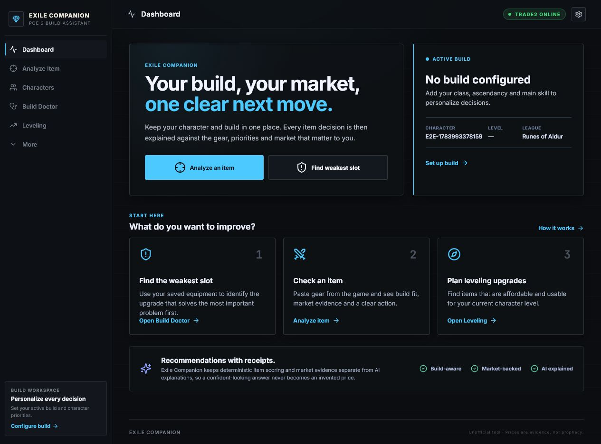
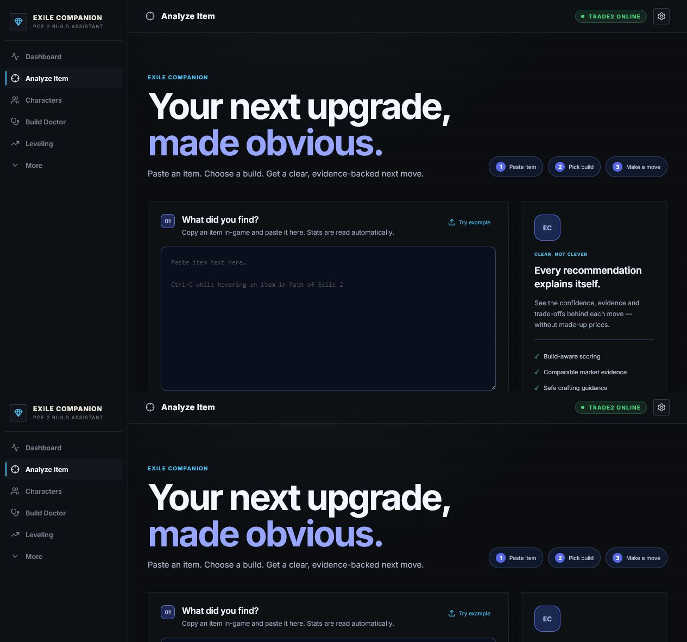
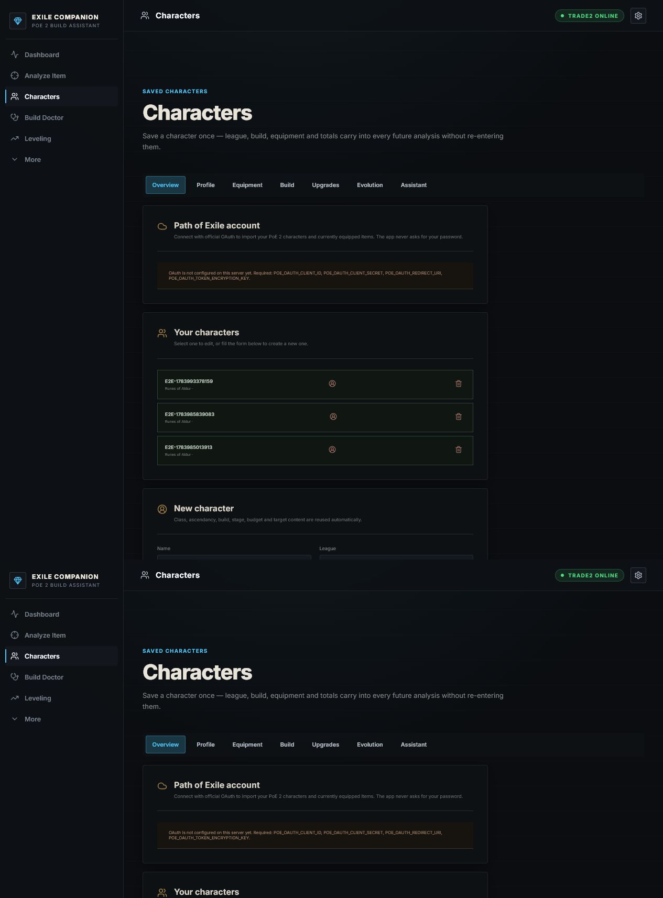
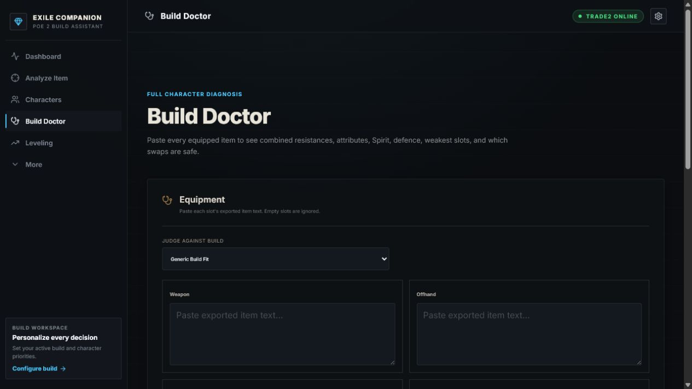
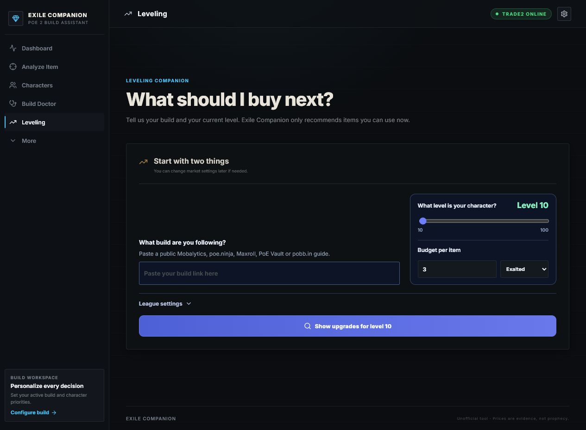
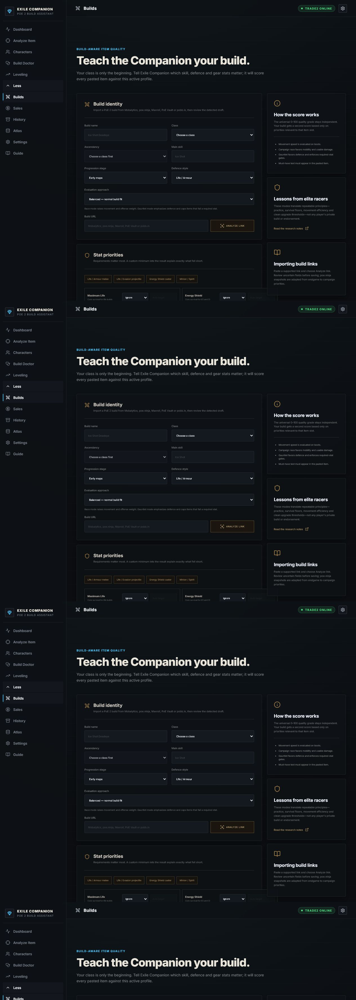
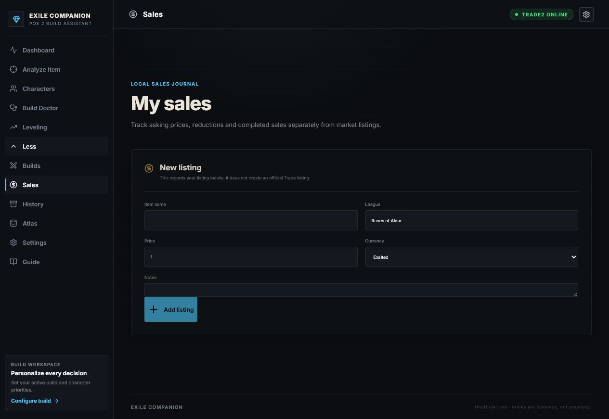
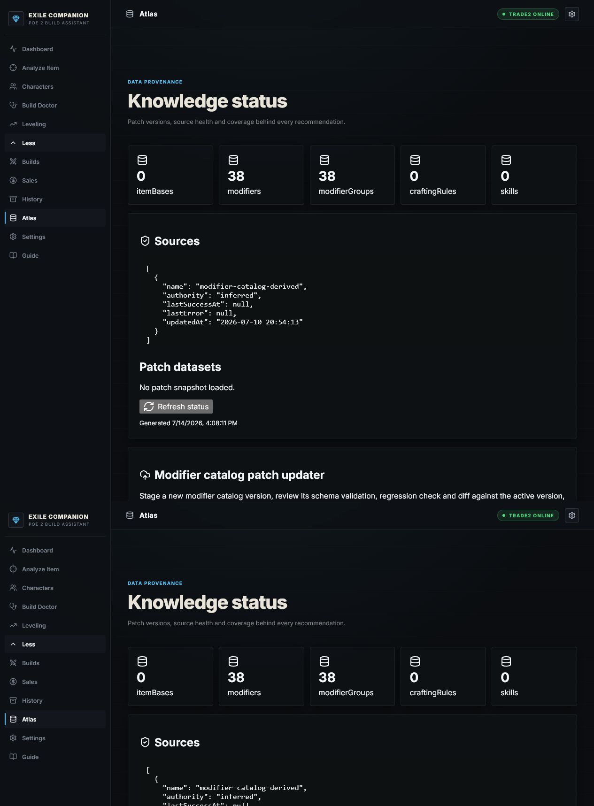
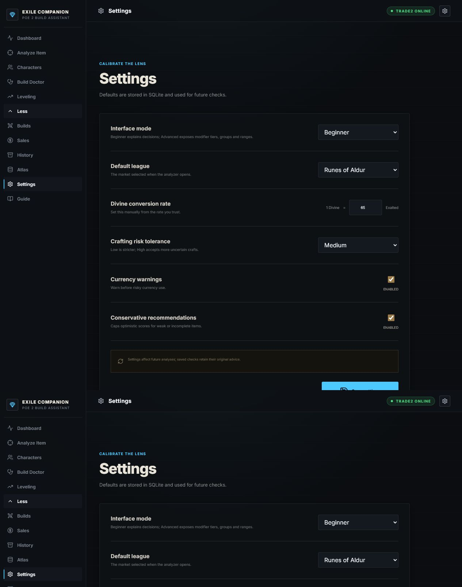
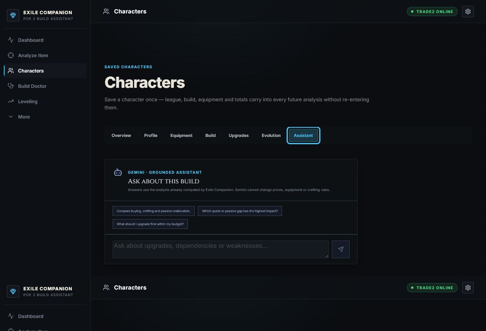

# Exile Companion — Guild Feature Tour

Exile Companion is an unofficial Path of Exile 2 companion focused on character progression, item decisions, build planning, and market evidence. It keeps deterministic calculations separate from AI explanations, so recommendations can show their sources and uncertainty.

## 1. Dashboard

The dashboard gives players a quick overview of their active build and the most useful next actions. It connects item analysis, weak-slot detection, and leveling upgrades in one starting screen.

## 2. Item Analyzer

Paste an item copied from the game to evaluate its stats, build fit, crafting potential, and market evidence. The app explains whether the item should be equipped, sold, crafted, or ignored instead of returning only a score.

## 3. Characters

Character workspaces keep league, class, ascendancy, equipment, build priorities, budget, and progression history together. Official Path of Exile OAuth integration is prepared for character import once application credentials are approved by GGG.

## 4. Build Doctor

Build Doctor reviews the complete equipment set and finds weak slots, missing attributes, resistance problems, Spirit pressure, and unsafe swaps. Upgrade priorities reuse the same scoring rules as the Item Analyzer.

## 5. Leveling Planner

The leveling planner searches for affordable upgrades that the character can actually equip at the selected level. It prioritizes the weakest slots and keeps price, level requirements, and build relevance visible.

## 6. Build Workspace

The build workspace records the character archetype, main skill, defensive plan, important stats, and unwanted stats. These priorities personalize analysis across the rest of the application.

## 7. Sales Journal

The sales journal separates asking prices from completed sales. It tracks listing age and price changes, identifies stale listings, and can suggest a conservative price review without pretending that an active listing proves market value.

## 8. Knowledge and Patch Data

The knowledge area shows the versioned data used by the application. Patch catalogs can be staged, validated, regression-tested, activated, or rolled back without silently replacing trusted rules.

## 9. Settings and Safety Controls

Settings control exchange rates, crafting risk tolerance, warnings, authentication connections, account sessions, and operational preferences. Secrets remain on the backend and destructive actions require confirmation.

## 10. Gemini Build Assistant

The Gemini assistant answers questions about upgrades, passive choices, quests, crafting, purchases, and sales using structured character context. Deterministic findings remain the source of truth, while Gemini explains scenarios, evidence, confidence, and missing information.

## Important notice

This product is not affiliated with or endorsed by Grinding Gear Games in any way. Prices and recommendations are decision support, not guaranteed outcomes.
